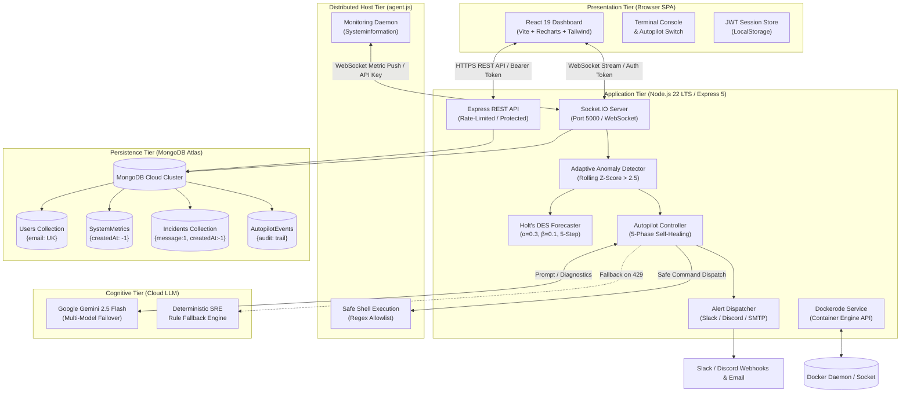
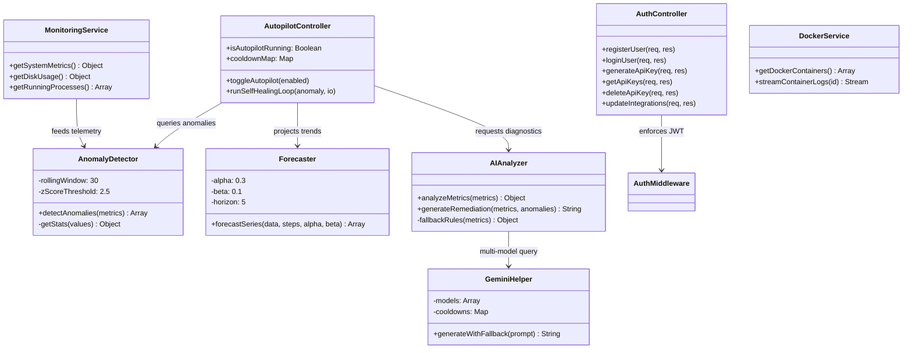
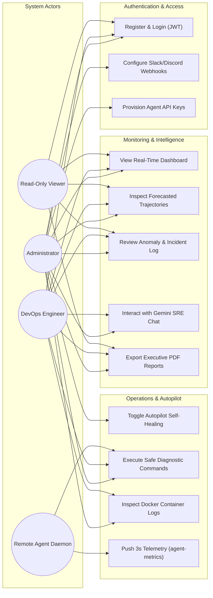
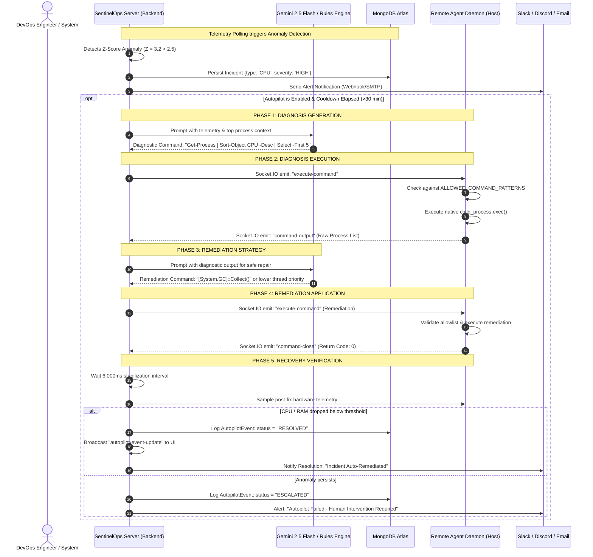
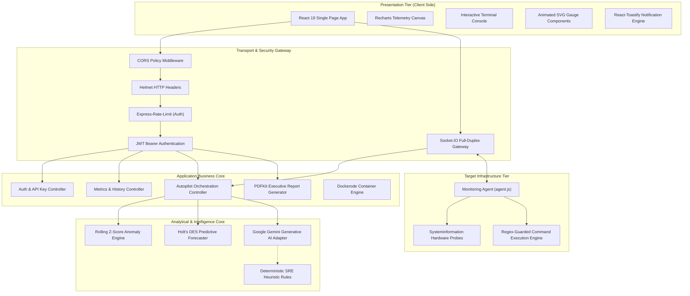

# SentinelOps AI - System Analysis & Design Diagrams (UML & Flowcharts)

This document contains all formal system diagrams for **SentinelOps AI - Infrastructure Monitoring and Anomaly Detection Platform** for the MCA Semester III Capstone Project.

---

## 1. System Architecture Diagram (Section 2.3)



---

## 2. Entity Relationship Diagram (ERD) (Section 2.4)

```mermaid
erDiagram
    USER ||--o{ API_KEY : "owns / generates"
    USER ||--o{ INCIDENT : "reviews / resolves"
    USER ||--o{ AUTOPILOT_EVENT : "triggers / inspects"
    
    USER {
        ObjectId _id PK
        string name "User full name"
        string email UK "Regex validated, lowercase"
        string password "Bcrypt hashed (10 rounds)"
        string role "admin | engineer | viewer"
        string slackWebhookUrl "Optional Slack alert endpoint"
        string discordWebhookUrl "Optional Discord alert endpoint"
        date createdAt "Automatic Mongoose timestamp"
        date updatedAt "Automatic Mongoose timestamp"
    }

    API_KEY {
        ObjectId _id PK
        string key UK "Hashed / prefixed token"
        string description "Friendly node label"
        ObjectId user FK "Reference to owning User"
        date createdAt "Issuance timestamp"
    }

    SYSTEM_METRIC {
        ObjectId _id PK
        number cpuUsage "CPU load % (0-100)"
        number memoryUsage "Used physical RAM (MB)"
        number freeMemory "Free RAM (GB)"
        number diskUsage "Storage utilisation %"
        number downloadSpeed "Inbound network (MB/s)"
        number uploadSpeed "Outbound network (MB/s)"
        string hostname "Reporting server node ID"
        date createdAt INDEX "Time-series descending index"
    }

    INCIDENT {
        ObjectId _id PK
        string type "CPU | MEMORY | NETWORK | DISK | SERVER_OFFLINE"
        string severity "HIGH | MEDIUM | LOW"
        string message INDEX "Descriptive anomaly summary"
        string server "Node identifier (default: Local)"
        date timestamp "Exact detection timestamp"
        date createdAt INDEX "Compound index with message"
    }

    AUTOPILOT_EVENT {
        ObjectId _id PK
        string serverId "Target agent node ID"
        string anomalyType "CPU | MEMORY | DISK | NETWORK"
        string diagnosisCommand "Generated diagnostic query"
        string diagnosisOutput "Raw stdout from agent"
        string remediationAction "Applied corrective command"
        string status "TRIGGERED | IN_PROGRESS | RESOLVED | FAILED"
        array steps "Audit trail timestamps"
        date createdAt "Event timestamp"
    }
```

---

## 3. Class Diagram (Section 2.5)



---

## 4. Use Case Diagram (Section 2.6)



---

## 5. Activity Diagram: Telemetry & Anomaly Loop (Section 2.7)

```mermaid
flowchart TD
    Start([Start Telemetry Loop Every 3,000ms]) --> Collect[Sample Hardware: CPU, Memory, Disk, Network]
    Collect --> Processes[Query Top-10 CPU Processes]
    Processes --> Broadcast[Broadcast Live Metrics over Socket.IO]
    Broadcast --> CheckHistory{Query last 30 snapshots from MongoDB}
    
    CheckHistory -->|Data count >= 5| CalcZ[Calculate Mean μ & StdDev σ]
    CheckHistory -->|Data count < 5| FallbackThresholds[Use Static Guard Thresholds]
    
    CalcZ --> EvalZ{Is |Z| > 2.5?}
    FallbackThresholds --> EvalStatic{CPU>85% or RAM>85% or Disk>90%?}
    
    EvalZ -->|Yes| FlagAnomaly[Construct Anomaly Incident Record]
    EvalZ -->|No| CheckDisk{Disk > 80% or Net > 20MB/s?}
    EvalStatic -->|Yes| FlagAnomaly
    EvalStatic -->|No| NormalState[System State Healthy]
    
    CheckDisk -->|Yes| FlagAnomaly
    CheckDisk -->|No| NormalState
    
    FlagAnomaly --> PersistDB[Save Incident to MongoDB with Index]
    FlagAnomaly --> DispatchAlerts[Dispatch Slack, Discord & Email Alerts]
    FlagAnomaly --> CheckAutopilot{Autopilot Enabled & Not in Cooldown?}
    
    CheckAutopilot -->|Yes| TriggerAutopilot[Trigger 5-Phase Autopilot Loop]
    CheckAutopilot -->|No / Cooldown| EmitUI[Emit system-anomalies to Dashboard]
    
    TriggerAutopilot --> EmitUI
    NormalState --> Sleep[Wait for Next 3-Second Tick]
    EmitUI --> Sleep
    Sleep --> Start
```

---

## 6. Sequence Diagram: 5-Phase Autopilot Self-Healing (Section 2.8)



---

## 7. Component Diagram (Section 2.9)



---

## 8. Module Hierarchy Diagram (Section 2.10)

```mermaid
flowchart TD
    Root["SentinelOps AI Platform (Root)"]
    
    Root --> Frontend["1. Frontend Subsystem (React 19 + Vite)"]
    Root --> Backend["2. Backend Subsystem (Node.js 22 + Express 5)"]
    Root --> Agent["3. Monitoring Daemon Subsystem (agent.js)"]
    Root --> Storage["4. Persistence Subsystem (MongoDB Atlas)"]

    Frontend --> F1["Pages (Landing, Login, Register, Dashboard)"]
    Frontend --> F2["Visualizers (GaugeCard, CPUChart, NetworkChart)"]
    Frontend --> F3["Controls (AutopilotConsole, TerminalConsole, DockerPanel)"]
    Frontend --> F4["Communication (Socket.IO Client, Fetch REST API)"]

    Backend --> B1["API Routes (/auth, /metrics, /incidents, /monitor, /reports)"]
    Backend --> B2["Security Pipeline (JWT, Bcrypt, RateLimit, Helmet, CORS)"]
    Backend --> B3["Intelligence Services (Z-Score Detector, Holt Forecaster, Gemini AI)"]
    Backend --> B4["Infrastructure Services (Dockerode, Nodemailer, Slack, Discord)"]

    Agent --> A1["Telemetry Probes (CPU, RAM, Disk fsSize, Network rx/tx)"]
    Agent --> A2["Process Monitor (Top 10 CPU Tasks)"]
    Agent --> A3["Command Executor (Regex-Guarded child_process.exec)"]

    Storage --> S1["Users Collection (Role-based credentials, webhooks)"]
    Storage --> S2["SystemMetrics Collection (Descending time-series index)"]
    Storage --> S3["Incidents Collection (Severity enums, compound index)"]
    Storage --> S4["AutopilotEvents Collection (Step-by-step audit trail)"]
```



